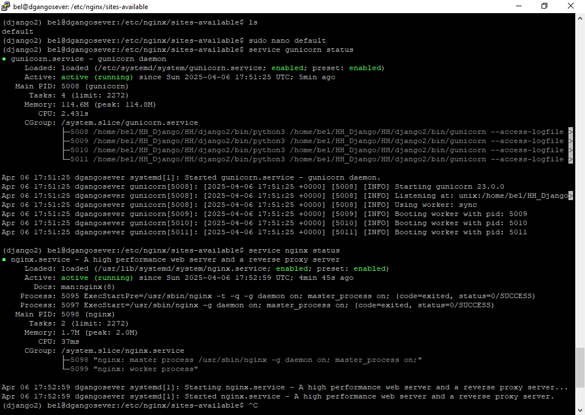
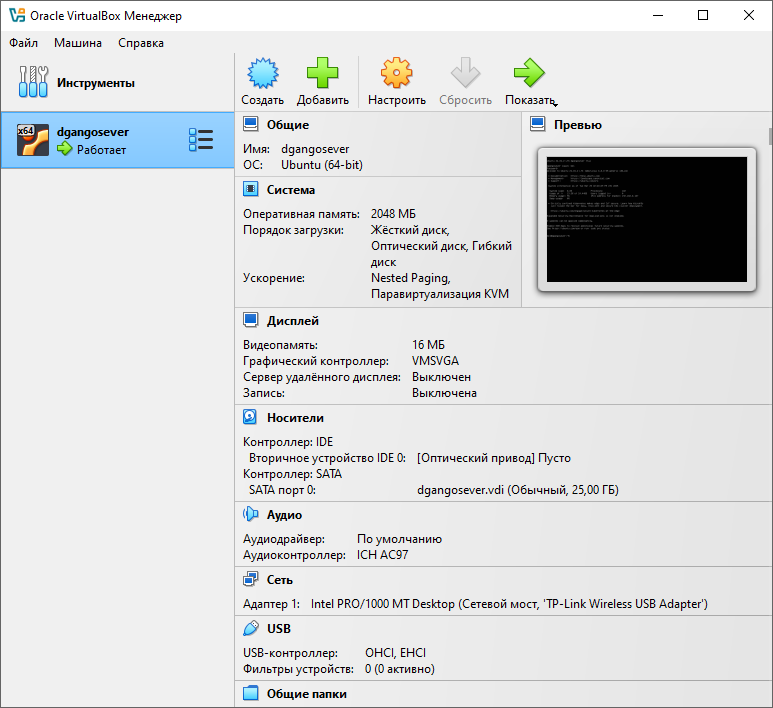
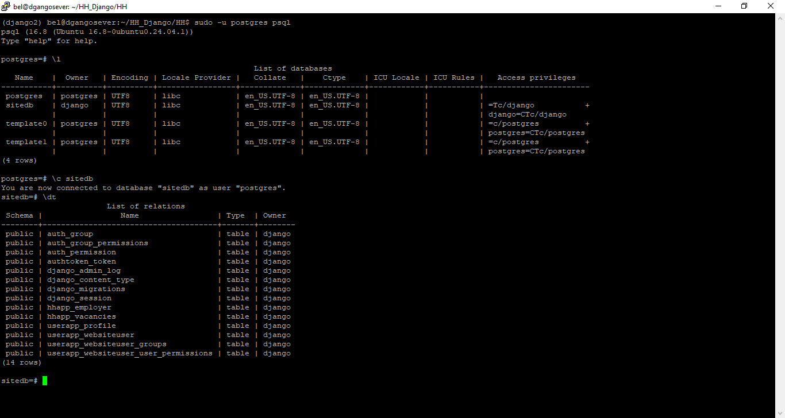
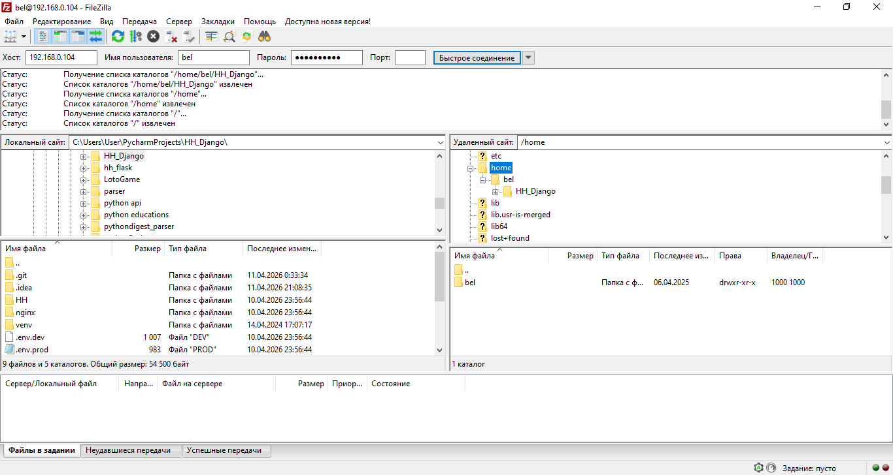

# HH Django — платформа поиска работы + AI-модуль

[](https://www.djangoproject.com/)
[](https://www.django-rest-framework.org/)
[](https://www.python.org/)

Учебный проект, выросший из первого диплома во второй. Сначала — платформа
поиска работы и сотрудников на Django и DRF: пользователи, вакансии,
работодатели, поиск через HH.ru, REST API, PostgreSQL, Docker и деплой на
сервер. Затем — AI-модуль, который анализирует требования вакансий, объясняет
навыки с опорой на базу знаний и проводит тестовое собеседование.

| | Диплом 1 — платформа | Диплом 2 — AI-модуль |
|---|---|---|
| Что решает | найти вакансии и работодателей | объяснить требования и подготовить кандидата |
| Ветка | `main` | [`AI_Agents_diploma`](https://github.com/Beluncho/HH_Django/tree/AI_Agents_diploma) |
| Данные | вакансии, работодатели, профили | снимки вакансий, навыки, база знаний, собеседования |
| Логика | CRUD, поиск, HH API, DRF | анализ, embeddings, RAG, LLM, оценка ответов |
| Инфраструктура | PostgreSQL, Docker, Nginx, Gunicorn | то же + хранение векторов в PostgreSQL |
| Тесты | тесты приложений | 90 тестов в 10 файлах без внешних запросов |

**Презентация защиты второго диплома:** <https://beluncho.github.io/HH_Django/>

Отчёты второго диплома: [эксперименты](https://github.com/Beluncho/HH_Django/blob/AI_Agents_diploma/docs/stage4_report.md) ·
[презентация](https://github.com/Beluncho/HH_Django/blob/AI_Agents_diploma/docs/stage5_report.md) ·
[наблюдаемость](https://github.com/Beluncho/HH_Django/blob/AI_Agents_diploma/docs/stage6_report.md).

---

## Диплом 1 — платформа поиска работы

### Возможности

- **Пользователи и роли**: соискатели и работодатели, кастомная модель
  `WebSiteUser`, профиль с фото и описанием.
- **Вакансии**: список с пагинацией, карточка, создание и редактирование,
  фильтр по названию и работодателю.
- **Работодатели**: список, карточка, создание, редактирование, удаление;
  доступ к чужим карточкам ограничен владельцем или администратором.
- **Поиск HH.ru**: запрос уходит в API HH.ru, результаты показываются отдельным
  списком и не сохраняются в локальную базу.
- **Парсер**: management-команда `full_db` сохраняет найденные вакансии и
  работодателей в базу.
- **REST API**: viewset-ы вакансий и работодателей с токен-аутентификацией и
  правами «читать может любой, писать — работодатель или администратор».
- **Админка** для управления контентом и пользователями.
- **Docker**: dev- и prod-конфигурации, PostgreSQL 16, Gunicorn и Nginx в
  production.

### Стек

Django 5.1.6, Django REST Framework 3.15.2, PostgreSQL 16, Docker Compose,
Nginx, Gunicorn, `requests`, Pillow.

### Деплой

Скриншоты из процесса развёртывания на сервере:

| | |
|---|---|
|  |  |
| Приложение в браузере | Подключение к серверу по SSH |
|  |  |
| Виртуальная машина | Сервер в VirtualBox |
|  |  |
| PostgreSQL | Передача файлов через FileZilla |

### API

Базовый префикс — `/api/v0/`.

| Метод | URL | Что делает |
|---|---|---|
| `GET` | `/api/v0/vacancies/` | список вакансий, пагинация |
| `POST` | `/api/v0/vacancies/` | создать вакансию (работодатель или админ) |
| `GET` | `/api/v0/vacancies/{id}/` | карточка вакансии |
| `GET` | `/api/v0/employers/` | список работодателей |
| `POST` | `/api/v0/employers/` | создать работодателя |
| `POST` | `/user/create-token/` | создать токен для текущего пользователя |
| `GET` | `/user/update-token-ajax/` | вернуть/обновить токен в JSON |

Аутентификация — `Token` или `Session`. Чтение доступно без авторизации,
запись — работодателю или администратору.

---

## Диплом 2 — AI-модуль `candidate_trainer`

Платформа умела искать вакансии, но не объясняла, что именно требуется
кандидату. Модуль добавляет три сценария:

1. **Анализ требований** — собрать до 20 вакансий HH.ru по запросу и региону,
   нормализовать навыки и посчитать, что действительно требуют.
2. **Объяснение навыка** — зачем навык нужен и что подтянуть, с цитатами из
   базы знаний (RAG).
3. **Тестовое собеседование** — вопросы по навыкам из анализа, оценка ответов
   по трём шкалам и рекомендации.

### Что добавилось

- 12 моделей: анализ, снимки вакансий, навыки, база знаний, объяснения,
  собеседования, журнал обращений к LLM;
- 10 сервисных модулей вместо логики во views;
- нормализация навыков: «Python 3», «питон» и «Python» — один навык;
- частота навыка считается по вакансиям, а не по упоминаниям;
- RAG на трёх коллекциях, локальные embeddings, cosine similarity;
- LLM как подключаемый провайдер: любой OpenAI-совместимый API или `disabled`;
- загрузка методичек в базу знаний из админки;
- журнал обращений к модели с телом ответа провайдера;
- 90 тестов в 10 файлах, без сети и внешних ключей.

### Исследование

Шесть экспериментов на 20 вакансиях и 57 навыках: частота по вакансиям,
`top-k = 5`, фрагмент 900 символов, MiniLM вместо хешей, две формулировки
промтов и лимит ответа 4000 токенов. Подробности —
[`docs/stage4_report.md`](https://github.com/Beluncho/HH_Django/blob/AI_Agents_diploma/docs/stage4_report.md).

### Где смотреть

- **Код модуля** — ветка [`AI_Agents_diploma`](https://github.com/Beluncho/HH_Django/tree/AI_Agents_diploma).
- **Презентация** — <https://beluncho.github.io/HH_Django/>.
- **Инструкция по запуску** — [`docs/candidate_trainer_setup.md`](https://github.com/Beluncho/HH_Django/blob/AI_Agents_diploma/docs/candidate_trainer_setup.md).
- **Журнал LLM и админка** — [`docs/stage6_report.md`](https://github.com/Beluncho/HH_Django/blob/AI_Agents_diploma/docs/stage6_report.md).

### Демо без ключей

```bash
git clone https://github.com/Beluncho/HH_Django.git
cd HH_Django
git checkout AI_Agents_diploma

python -m venv venv
venv\Scripts\activate                 # Linux/macOS: . venv/bin/activate
pip install "Django==5.1.6" "djangorestframework==3.15.2" requests

cp .env.local.example .env.local      # достаточно SECRET_KEY
./run_local.sh migrate
./run_local.sh loaddata demo_analysis
./run_local.sh runserver
```

Вход в тренажёр — `http://127.0.0.1:8000/trainer/`, пользователь
`demo` / `demo1234`. В демо-выгрузке уже есть анализ на 8 вакансий, 36 навыков,
120 фрагментов базы знаний и 2 готовых объяснения.

---

## Быстрый старт (платформа)

### Docker

```bash
git clone https://github.com/Beluncho/HH_Django.git
cd HH_Django

cp .env.dev.example .env.dev
# заполнить SECRET_KEY, HH_USER_AGENT и HH_ACCESS_TOKEN

docker compose up -d --build
docker compose exec web python manage.py createsuperuser
```

Приложение — <http://127.0.0.1:8000/>, админка — `/admin/`.

Production-конфигурация:

```bash
cp .env.prod.example .env.prod
# заменить SECRET_KEY, POSTGRES_PASSWORD и ALLOWED_HOSTS

docker compose -f docker-compose.prod.yml up -d --build
# http://127.0.0.1:1337/
```

### Без Docker

```bash
python -m venv venv
venv\Scripts\activate                 # Linux/macOS: . venv/bin/activate
pip install -r HH/requirements.txt

export SECRET_KEY=local-secret
export DEBUG=1
export ALLOWED_HOSTS="localhost 127.0.0.1"
export HH_USER_AGENT="HH_Django/1.0 (you@example.com)"

cd HH
python manage.py migrate
python manage.py runserver
```

Без PostgreSQL используется SQLite (`HH/db.sqlite3`). Переменные окружения
читаются из процесса: файл `.env` Django сам не загружает.

### Переменные HH.ru

```dotenv
HH_API_DOMAIN=https://api.hh.ru/
HH_ACCESS_TOKEN=...          # токен приложения HH.ru
HH_USER_AGENT=HH_Django/1.0 (you@example.com)
HH_REQUEST_TIMEOUT=10
```

Токен нужен для запросов к HH API; без него поиск вернёт понятную ошибку.

---

## Структура

```text
HH_Django/
├── HH/
│   ├── HH/                  # настройки, urls, wsgi
│   ├── hhapp/               # вакансии, работодатели, HH API, DRF
│   ├── userapp/             # WebSiteUser, профиль, регистрация, токены
│   ├── candidate_trainer/   # AI-модуль (ветка AI_Agents_diploma)
│   ├── templates/, static/
│   └── requirements.txt
├── docs/                    # отчёты и презентация (AI-ветка)
├── nginx/
├── docker-compose.yml
└── docker-compose.prod.yml
```

## Документация

- [`AI_Agents_diploma/docs/candidate_trainer_setup.md`](https://github.com/Beluncho/HH_Django/blob/AI_Agents_diploma/docs/candidate_trainer_setup.md) — запуск AI-модуля, RAG, LLM;
- [`AI_Agents_diploma/docs/stage4_report.md`](https://github.com/Beluncho/HH_Django/blob/AI_Agents_diploma/docs/stage4_report.md) — эксперименты;
- [`AI_Agents_diploma/docs/stage6_report.md`](https://github.com/Beluncho/HH_Django/blob/AI_Agents_diploma/docs/stage6_report.md) — журнал LLM и администрирование;
- [Презентация](https://beluncho.github.io/HH_Django/).

## Ограничения

- Поиск HH.ru ограничен 20 вакансиями за запрос; результаты поиска не
  сохраняются в локальную базу — для этого есть команда `full_db`.
- Повторный запуск `full_db` может добавить дубликаты вакансий.
- Аутентификация API — токен или сессия; OAuth-поток HH.ru не реализован.
- AI-модуль доступен только в ветке `AI_Agents_diploma`; в `main` его нет.

## Автор

Александр Белов — [GitHub](https://github.com/Beluncho).
